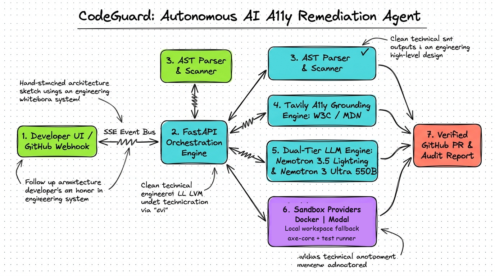
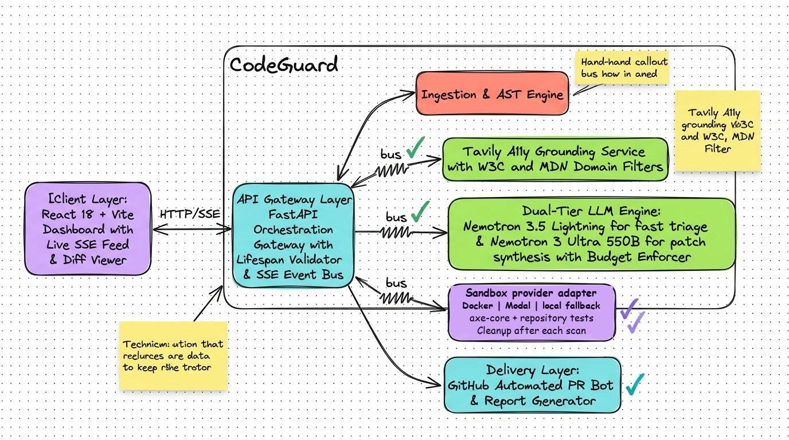
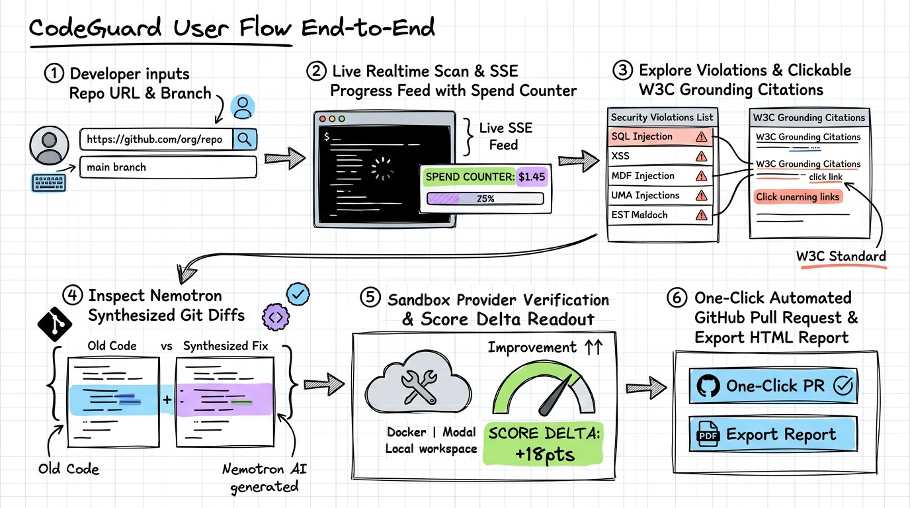

# CodeGuard 🛡️

> **Autonomous AI Accessibility Remediation Agent powered by NVIDIA Nemotron & Nebius AI Cloud.**

[](LICENSE)
[](https://fastapi.tiangolo.com)
[](https://reactjs.org)
[](https://developer.nvidia.com)
[](https://nebius.com)
[](https://tavily.com)
[](https://github.com/dhanushkumar-amk/CODEGUARD---NVIDIA-HACKTHON-PROJECT/actions/workflows/ci.yml)
[](https://codeguard.dhanushkumar.in/)

---

## 🎬 Demo Walkthrough


*Watch CodeGuard scan a frontend repository, stream real-time violation diagnosis, verify proposed patches with its configured sandbox provider, and open an automated GitHub Pull Request.*

---

## 💡 What It Does

**CodeGuard** is an autonomous accessibility agent designed to eliminate digital accessibility barriers directly within software development workflows. When provided with a public Git repository URL, CodeGuard executes an end-to-end audit, remediation, and verification pipeline:

1. **Intelligent Ingestion & Scanning**: CodeGuard performs a lightweight shallow clone of the target repository, discovers all user interface files (`.tsx`, `.jsx`, `.html`, `.vue`, `.svelte`), and constructs token-efficient abstract syntax batches. Using **NVIDIA Nemotron 3.5 Lightning**, it rapidly audits hundreds of code blocks in parallel against the **WCAG 2.2 AA** specification, flagging unlabeled form elements, missing alternative text, broken focus traps, keyboard accessibility failures, and color contrast defects.
2. **Authoritative Web Search Grounding via Tavily**: Before diagnosing root causes or generating patches, CodeGuard queries **Tavily AI Search** restricted strictly to authoritative a11y bodies (`w3.org`, `developer.mozilla.org`, `webaim.org`, `dequeuniversity.com`, `a11yproject.com`). It extracts live WCAG 2.2 techniques and verified accessible markup examples, injecting them directly into the Nemotron prompt context to ground generation in official standards rather than hallucinated patterns.
3. **Contextual Diagnosis & Patch Synthesis**: For critical accessibility violations, CodeGuard routes the problematic code and authoritative guidance to **NVIDIA Nemotron 3 Ultra (550B)**. The model analyzes component hierarchy, state management, and user interaction patterns to synthesize clean, idiomatic code remediations, generating exact unified git diffs rather than generic advice.
4. **Sandbox Verification & PR Automation**: CodeGuard prepares a verification workspace through its sandbox provider, applies a proposed patch, runs axe-core and the repository test command when available, then records the verification result. Supported providers are Docker, Modal, and a local workspace fallback. The local fallback is intended for development and is not an OS-level security boundary. Reports can be exported as HTML/Markdown, and eligible verified fixes can be submitted as a GitHub pull request.

---

## 🌍 Why It Matters

Over **1.3 billion people** worldwide—approximately 16% of the global population—live with significant disabilities. Despite clear international legal standards (such as Section 508 and the European Accessibility Act), **96% of the world's top one million websites fail basic accessibility checks** ([WebAIM Million](https://webaim.org/projects/million/)).

Most development teams want to build inclusive software, but traditional accessibility tooling creates severe bottlenecks:
- **Linting tools** (e.g., `eslint-plugin-jsx-a11y`) only identify static syntax errors and cannot fix them or understand dynamic component interactions.
- **Manual accessibility audits** cost tens of thousands of dollars, take weeks to complete, and produce lengthy PDF reports that quickly become outdated.
- **Generic AI code assistants** frequently produce hallucinated patches that break unit tests or introduce subtle regressions.

CodeGuard transforms digital accessibility from a painful, manual compliance chore into an autonomous, continuous engineering workflow—ensuring the web becomes accessible to everyone, by default.

---

## ⚡ How It Uses Nebius Token Factory

CodeGuard implements a tiered, cost-optimized LLM orchestration architecture powered by **Nebius Token Factory**:

- **High-Throughput AST Triage via Nemotron 3.5 Lightning**:
  - Priced at just **$0.06 / 1M input tokens** and **$0.24 / 1M output tokens**, Lightning performs rapid AST batch evaluation, rule classification, and violation scoring across dozens of files simultaneously with sub-second Time-to-First-Token (TTFT).
- **Deep Contextual Remediation via Nemotron 3 Ultra (550B)**:
  - Complex accessibility challenges (such as accessible focus trapping, keyboard navigation for custom tablists, and dynamic ARIA live regions) require deep multi-step reasoning. CodeGuard routes these high-severity items to Nemotron 3 Ultra to synthesize production-ready unified diffs.
- **Strict In-Memory Budget Guardrails**:
  - Each scan session is protected by strict budget limits (`ULTRA_MAX_CALLS_PER_SCAN=10` and `ULTRA_BUDGET_USD_PER_SCAN=$0.05`). If the threshold is reached, CodeGuard gracefully falls back to the fast tier, guaranteeing zero unexpected credit drain.
- **Real-World Cost Efficiency**:
  - In our Phase 28 rehearsal scanning **65 frontend files** across **90 batch chunks**, CodeGuard completed the entire end-to-end scan and remediation generation for a total LLM cost of just **$0.0412 (~4.1¢)**.

---

## How Sandbox Verification Works

The sandbox client provides one interface for workspace creation, file transfer, command execution, timeouts, and cleanup. For a scan, CodeGuard creates a clean baseline workspace and installs dependencies when a supported package manifest is found. Each proposed fix is tested in a fresh verification workspace: the patch is applied, axe-core is run, and the repository test command is executed when available. Sandbox IDs are tracked per scan and cleaned up after the pipeline completes.

```text
[Prepare repository] -> [Create baseline workspace]
                               |
[Report / optional PR] <- [Record axe + test results]
                               ^
                [Fresh workspace per fix]
                   |-- Apply proposed patch
                   |-- Run axe-core check
                   `-- Run repository tests
```

### Sandbox providers

- **Docker** (`SANDBOX_PROVIDER=docker`, default): starts a disposable container when Docker is available. If Docker cannot be reached, the current implementation falls back to the local workspace provider.
- **Modal** (`SANDBOX_PROVIDER=modal`): provisions a Modal Sandbox using the configured Modal account and the Playwright image defined by the sandbox client.
- **Local workspace**: stores files in a temporary directory and runs commands as local subprocesses. This is useful for development and tests, but it does not isolate untrusted repository code from the host. Do not use it as a security boundary for arbitrary repositories.

Dependency installation and browser availability depend on the selected provider and target repository. A passing axe scan and test command are useful verification signals; they do not establish complete WCAG conformance or guarantee that a generated patch is correct. Review changes before merging.

---

## 🌐 Web Search Grounding via Tavily

To eliminate LLM hallucinations and anchor remediations directly to verified accessibility engineering practices, CodeGuard integrates **Tavily AI Search**:

1. **Domain-Restricted Retrieval**:
   - Web searches are strictly restricted to trusted accessibility authorities: `w3.org`, `developer.mozilla.org` (MDN), `webaim.org`, `dequeuniversity.com`, and `a11yproject.com`.
   - Before diagnosis and patch synthesis, CodeGuard queries these domains for exact WCAG 2.2 techniques (e.g., `H37`, `ARIA1`, `G183`) and verified accessible markup examples matching each violation category.
2. **Dynamic Prompt Injection**:
   - Retrieved guidance and code snippets are formatted into Nemotron 3 Ultra prompts as high-priority reference blocks, explicitly directing the model to prioritize official web standards over parametric training memory.
3. **Process-Lifetime Caching & Budget Controls**:
   - Guidance is cached in-memory per violation category across the scan lifecycle, minimizing redundant API requests and search costs (`TAVILY_MAX_SEARCHES_PER_SCAN=12`).
4. **Transparent Source Attribution**:
   - Every diagnosed violation and proposed patch includes clickable source citations linking directly to the underlying W3C or MDN standard in both the web UI and exported audit reports.
5. **Resilient Non-Blocking Fallback**:
   - If Tavily searches encounter network timeouts or an absent API key, CodeGuard gracefully falls back to parametric model synthesis without blocking the remediation pipeline.

---

## 🧠 NVIDIA Nemotron Models Used

CodeGuard relies on the following official model endpoints hosted on Nebius Token Factory (configured in [`backend/app/config.py`](backend/app/config.py)):

| Purpose | Model ID | Capabilities |
| :--- | :--- | :--- |
| **Fast Scanning & Triage** | `nvidia/Nemotron-3_5-Lightning` | High-throughput parsing, WCAG rule categorization, rapid token streaming |
| **Deep Reasoning & Fixes** | `nvidia/Nemotron-3-Ultra-550b-a55b` | 550B parameter deep reasoning, stateful ARIA logic, unified diff generation |

---

## 🏛️ Architecture & High-Level Design (HLD)

For the full architectural specification, pipeline flowcharts, sandbox provider details, and resilience notes, read [**docs/HLD.md**](docs/HLD.md).

### 🎨 Hand-Drawn Architectural Blueprint



### 📐 Hand-Drawn Component Topology Blueprint



- **Client Layer**: React 18 + Vite dashboard with live SSE stream subscription, diff previewer, and budget spending monitor.
- **API Gateway Layer**: FastAPI orchestration gateway with startup credential validation and asynchronous pub/sub event bus.
- **Ingestion & AST Engine**: Shallow git clone worker and markup parser extracting component AST chunks.
- **Tavily Grounding Service**: Domain-restricted retriever querying W3C, MDN, and Deque for official WCAG 2.2 techniques.
- **Dual-Tier LLM Engine**: Cost-optimized routing pairing **Nemotron 3.5 Lightning** (fast triage) with **Nemotron 3 Ultra 550B** (patch synthesis) protected by strict budget limits.
- **Sandbox Provider Adapter**: Docker containers, Modal Sandboxes, or a local workspace fallback for development; runs axe-core and repository tests where configured.
- **Delivery Layer**: Automated GitHub Pull Request bot and comprehensive compliance report exporter (HTML/JSON/Markdown).

---

## 🗺️ End-to-End User Flow

For the complete interactive user journey, sequence diagrams, and step-by-step breakdown, read [**docs/USER_FLOW.md**](docs/USER_FLOW.md).

### 🎨 Hand-Drawn User Flow Blueprint



### 🚀 Developer Journey at a Glance

```text
  [1. Input Repo URL] ──► [2. Live Real-Time Audit & SSE Feed] ──► [3. Explore Violations & MDN Grounding]
                                                                                │
  [6. Automated GitHub PR] ◄── [5. Provider Sandbox Verification] ◄── [4. Inspect Nemotron Git Diffs]
```

---

## 🌐 Live Demo & Deployments

- **Deployed Web Dashboard**: [https://codeguard.dhanushkumar.in/](https://codeguard.dhanushkumar.in/)
- **Live Backend API**: [https://codeguard-backend-6pg4.onrender.com](https://codeguard-backend-6pg4.onrender.com)
- **API Health Check**: [https://codeguard-backend-6pg4.onrender.com/health](https://codeguard-backend-6pg4.onrender.com/health)
- **Interactive Swagger Docs**: [https://codeguard-backend-6pg4.onrender.com/docs](https://codeguard-backend-6pg4.onrender.com/docs)
- **Live WebSocket Endpoint**: `wss://codeguard-backend-6pg4.onrender.com/ws/{scan_id}`
- **Automated Pull Request Generated by CodeGuard**: [GitHub PR #2](https://github.com/dhanushkumar-amk/CODEGUARD-NVIDIA-HACKTHON-PROJECT/pull/2)

---

## 💻 Setup Instructions

Follow these steps to run CodeGuard locally.

### Prerequisites
- **Python 3.11+**
- **Node.js 18+** & **npm**
- **Git**

### 1. Clone the Repository
```bash
git clone https://github.com/dhanushkumar-amk/CODEGUARD---NVIDIA-HACKTHON-PROJECT.git
cd CODEGUARD---NVIDIA-HACKTHON-PROJECT
```

### 2. Backend Setup (FastAPI)
```bash
cd backend

# Create and activate virtual environment
# Windows (PowerShell):
python -m venv .venv
.venv\Scripts\Activate.ps1

# Linux / macOS:
python3 -m venv .venv
source .venv/bin/activate

# Install dependencies
pip install -r requirements.txt

# Configure environment variables
cp .env.example .env
```

Edit `backend/.env` with your API credentials (refer to `backend/.env.example` and `backend/.env.production.example` for reference):
```env
NEBIUS_TOKEN_FACTORY_API_KEY=your_nebius_api_key_here
SANDBOX_PROVIDER=docker  # docker (default), modal, or local fallback when Docker is unavailable
SANDBOX_DEFAULT_IMAGE=node:20-slim
GITHUB_TOKEN=your_personal_access_token_here      # required for automated PR creation
TAVILY_API_KEY=your_tavily_api_key_here          # required for live WCAG web grounding
```

Start the backend server:
```bash
uvicorn app.main:app --reload --host 0.0.0.0 --port 8000
```
Verify the backend is live at [http://localhost:8000/health](http://localhost:8000/health).

### 3. Frontend Setup (React + Vite)
In a new terminal window:
```bash
cd frontend

# Install dependencies
npm install

# Configure environment variables
cp .env.example .env

# Start Vite development server
npm run dev
```
Open [http://localhost:5173](http://localhost:5173) in your browser.

### 4. Running the Test Suites
```bash
# Run backend pytest suite
cd backend
pytest -v

# Run frontend test suite
cd frontend
npm test
```

---

## 🛠️ Tech Stack

Extracted from [**docs/tech-stack.md**](docs/tech-stack.md):

- **Backend**: Python 3.11, FastAPI, Pydantic v2, Uvicorn, GitPython, Tenacity (retry handling), HTTPX
- **Frontend**: React 18, TypeScript, Vite, Tailwind CSS, Framer Motion, Recharts, Lucide React
- **AI & Inference**: Nebius Token Factory, NVIDIA Nemotron 3.5 Lightning, NVIDIA Nemotron 3 Ultra (550B)
- **Web Search Grounding**: Tavily AI Search (`tavily-python`), domain-restricted WCAG retrieval
- **Verification & Sandboxing**: Docker / Modal / local workspace provider, Playwright, axe-core, Headless Chromium
- **Real-time Protocol**: Native WebSockets for low-latency pipeline streaming

---

## 🔁 CI/CD Pipeline

CodeGuard maintains a simple, robust continuous integration and deployment pipeline powered by GitHub Actions:

### 1. Continuous Integration (`.github/workflows/ci.yml`)
Triggered automatically on every pull request and push to `main` / `master`. Runs four parallel jobs with cancellation of obsolete runs (`cancel-in-progress: true`):
- **Backend Quality**: Sets up Python 3.11, validates syntax and style with Ruff, and executes the 144-test Pytest suite with 100% mocked external APIs (zero live keys required).
- **Frontend Quality**: Sets up Node 20, runs clean install (`npm ci`), verifies type safety (`tsc --noEmit`), runs 24 Vitest unit tests, and builds the production bundle (`npm run build`).
- **Container Build Test**: Validates that `backend/Dockerfile` builds cleanly using `docker/build-push-action` and GitHub Actions caching without pushing.
- **Secret Detection**: Runs **Gitleaks** across the complete git commit history to guarantee no API keys, private tokens, or credentials are committed.

### 2. Continuous Delivery (`.github/workflows/deploy.yml`)
Triggered automatically when the CI workflow succeeds on `master` (via `workflow_run`) or manually on-demand (`workflow_dispatch`):
- **Container Packaging**: Logs into GitHub Container Registry (`ghcr.io`), builds, and publishes multi-stage backend images tagged with the commit SHA and `latest`.
- **Nebius Endpoint Deployment**: Deploys the published container to Nebius Serverless AI Endpoints using the official Nebius CLI.
- **Automated Health Smoke Test**: Executes a 3-minute retry loop against `GET /health` on the live API URL. If the health endpoint fails to return 200 OK within 180 seconds, the workflow fails, preserving previous revisions.
- **Frontend GitHub Pages**: Deploys the compiled frontend with repository-configured API and WebSocket base URLs (`VITE_API_BASE_URL` and `VITE_WS_BASE_URL`), creating a `404.html` SPA routing fallback.

### 3. Manual Deployment (`workflow_dispatch`)
To trigger a manual production deployment without a new git commit:
1. Navigate to repository **Actions** tab on GitHub.
2. Select the **CD** workflow in the left sidebar.
3. Click **Run workflow**, choose the branch (e.g., `master`), and click **Run workflow**.

### 4. Rolling Back to a Previous Version
Every deployment pushes an immutable image tagged with the commit SHA: `ghcr.io/<owner>/codeguard-backend:<git-sha>`.
To roll back to a known stable image:
```bash
# Using Nebius CLI:
nebius ai endpoint create \
  --name codeguard-backend \
  --image ghcr.io/<owner>/codeguard-backend:<previous-sha> \
  --parent-id $NEBIUS_PROJECT_ID \
  --container-port 8000
```

---

## 🔍 Known Limitations

We believe in complete engineering honesty. The following real-world limitations were documented during our Phase 28 rehearsal:

1. **In-Memory Scan State**:
   - Scan jobs, token counters, and progress states are maintained in-memory on the backend process. If the server restarts, historical scan state is cleared. *(Production roadmap: Redis + PostgreSQL persistence).*
2. **Heading-Order Violations Require Holistic Review**:
   - While CodeGuard flags heading skips (`<h1>` directly followed by `<h3>`), remediating global heading hierarchy across multiple decoupled components often requires site-wide layout refactoring rather than local single-file patches.
3. **GitHub Pull Request Creation Requires Repository Write Permissions**:
   - Automated PR creation relies on a GitHub Personal Access Token (`GITHUB_TOKEN`). CodeGuard can only push remediation branches and open PRs on repositories where the token has write/collaborator permissions. Scans on foreign or read-only repos still provide full reports and downloadable diffs.
4. **Sandbox Provider and Isolation Depend on Configuration**:
   - Docker or Modal should be selected for isolated verification. The local workspace fallback executes subprocesses on the backend host and is intended only for development; it is not suitable for running untrusted repositories as an isolation boundary. Fresh workspaces may also incur dependency-installation and browser setup time.

---

## 🚀 What We'd Build Next

1. **Persistent Multi-Tenant Storage & Dashboard**: Integrate PostgreSQL and Redis to persist audit logs, track team compliance scores over time, and support multi-tenant organizations.
2. **CI/CD GitHub Action & Pre-Commit Hook**: Package CodeGuard as a native GitHub Action to automatically fail pull requests that introduce new WCAG 2.2 AA violations before code merges.
3. **Dynamic Multimodal Accessibility**: Expand beyond static markup to evaluate live audio/video closed captions, dynamic internationalization (i18n) screen-reader announcements, and animated motion reduction (`prefers-reduced-motion`).

---

## 📄 License

MIT — see [LICENSE](LICENSE).
