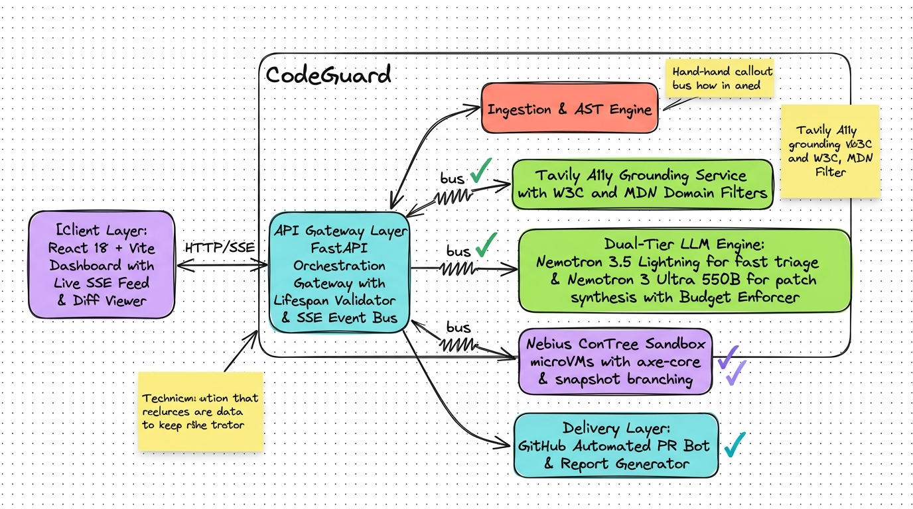
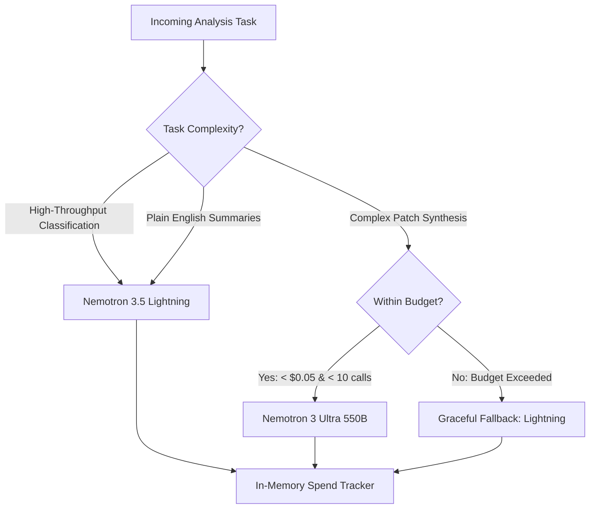
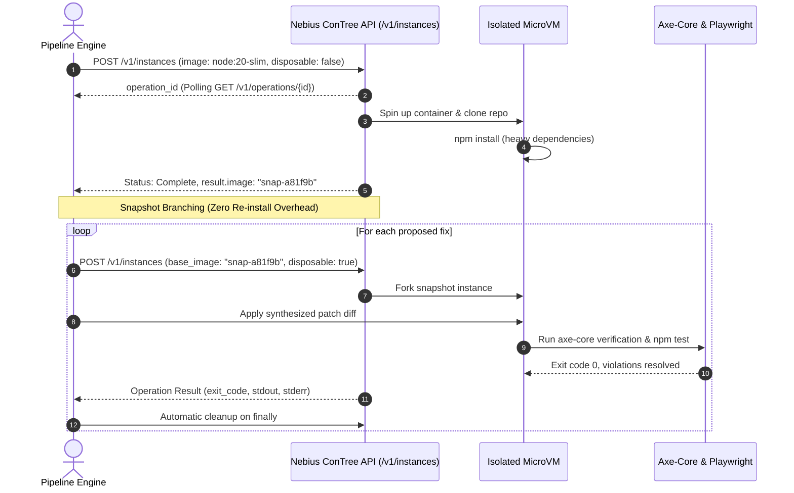

# CodeGuard: High-Level Design (HLD) Specification
> **Autonomous AI Accessibility Remediation Agent powered by NVIDIA Nemotron & Nebius AI Cloud**

---

## 1. Executive Overview & Strategic Mission

**CodeGuard** is an autonomous engineering agent designed to eliminate digital accessibility barriers directly within modern software development lifecycles. Rather than stopping at reporting static lint warnings or dumping generic advice, CodeGuard executes a self-contained, closed-loop remediation pipeline:
1. **Ingests** target Git repositories and parses UI components.
2. **Grounds** accessibility rules against live, authoritative standards (W3C WCAG 2.2 AA, MDN, Deque) via Tavily AI Search.
3. **Diagnoses & Synthesizes** minimal unified Git diffs using NVIDIA Nemotron models.
4. **Empirically Verifies** candidate patches in isolated Nebius ConTree microVM sandboxes using `@axe-core/playwright` and native regression test suites.
5. **Generates** verifiable compliance reports and automated GitHub Pull Requests.

---

## 2. Hand-Drawn Architectural Blueprint

The following architectural sketch captures the complete component topology, event bus, dual-tier LLM routing, and microVM verification loop in a whiteboard sketch style:


---

## 3. Hand-Drawn Component Topology Blueprint

The following whiteboard sketch breaks down CodeGuard's internal component topology, layer separation, event bus interconnects, and sandbox subsystem:



### Component Topology Overview:
- **Client Layer**: React 18 + Vite dashboard with live SSE stream subscription, diff previewer, and budget spending monitor.
- **API Gateway Layer**: FastAPI orchestration gateway with startup credential validation and asynchronous pub/sub event bus.
- **Ingestion & AST Engine**: Shallow git clone worker and markup parser extracting component AST chunks.
- **Tavily Grounding Service**: Domain-restricted retriever querying W3C, MDN, and Deque for official WCAG 2.2 techniques.
- **Dual-Tier LLM Engine**: Cost-optimized routing pairing **Nemotron 3.5 Lightning** (fast triage) with **Nemotron 3 Ultra 550B** (patch synthesis) protected by strict budget limits.
- **Nebius ConTree Sandbox microVMs**: Ephemeral containerized verification running `@axe-core/playwright` and test suites with snapshot branching.
- **Delivery Layer**: Automated GitHub Pull Request bot and comprehensive compliance report exporter (HTML/JSON/Markdown).

---

## 4. End-to-End Pipeline Stages

```mermaid
flowchart LR
    A([1. Clone & Scan]) --> B([2. Classify])
    B --> C([3. Ground])
    C --> D([4. Diagnose])
    D --> E([5. Fixes])
    E --> F([6. Verify])
    F --> G([7. Calculate])
    G --> H([8. Report & PR])

    style A fill:#00C7B7,stroke:#333,stroke-width:2px,color:#fff
    style B fill:#00C7B7,stroke:#333,stroke-width:2px,color:#fff
    style C fill:#6C5CE7,stroke:#333,stroke-width:2px,color:#fff
    style D fill:#76B900,stroke:#333,stroke-width:2px,color:#fff
    style E fill:#76B900,stroke:#333,stroke-width:2px,color:#fff
    style F fill:#FD79A8,stroke:#333,stroke-width:2px,color:#fff
    style G fill:#0984E3,stroke:#333,stroke-width:2px,color:#fff
    style H fill:#E17055,stroke:#333,stroke-width:2px,color:#fff
```



### Stage 1: Ingestion & Discovery
- Performs a shallow clone (`--depth 1`) of the target repository into an isolated temporary workspace.
- Detects frontend framework and crawls all markup-bearing files (`.tsx`, `.jsx`, `.html`, `.vue`, `.svelte`).
- Extracts code snippets, component boundaries, and dependency manifests (`package.json`).

### Stage 2: AST Markup Extraction & Heuristic Triage
- Constructs token-bounded code chunks for analysis.
- Runs fast heuristic checks alongside static pattern matching to identify immediate WCAG non-compliances (missing `alt` tags, broken ARIA roles, unassociated form inputs).

### Stage 3: High-Throughput Classification (Nemotron 3.5 Lightning)
- Evaluates code blocks against WCAG 2.2 AA success criteria.
- Assigns severity weights: `CRITICAL` (1.0), `SERIOUS` (0.7), `MODERATE` (0.4), `MINOR` (0.1).
- Generates precise line pointers and code context snippets.

### Stage 4: Authoritative Web Grounding (Tavily AI Search)
- Before reasoning about root causes or synthesizing fixes, queries Tavily restricted strictly to trusted domains:
  - `w3.org`
  - `developer.mozilla.org`
  - `webaim.org`
  - `dequeuniversity.com`
  - `a11yproject.com`
- Extracts canonical WCAG 2.2 techniques and verified accessible markup patterns.
- Caches query results in-memory by violation category to avoid duplicate network latency and API costs.

### Stage 5: Contextual Diagnosis & Patch Synthesis (Nemotron 3 Ultra 550B)
- Injects grounded W3C/MDN snippets directly into the prompt context.
- Invokes Nemotron 3 Ultra (550B) to reason through complex accessibility patterns:
  - Accessible focus management and focus traps
  - Dynamic ARIA live regions and announcements
  - Keyboard navigation for custom widgets (comboboxes, accordions)
  - Color contrast and responsive reflow
- Emits clean, unified git diffs targeting only the offending lines.

### Stage 6: Isolated MicroVM Verification (Nebius ConTree)
- Launches an isolated container microVM via the Nebius ConTree Sandbox API.
- Applies candidate git patches in the container filesystem.
- Runs `@axe-core/playwright` audits to empirically prove the defect was resolved.
- Triggers the repository's native test suite (`npm test`, `jest`, `vitest`) to guarantee zero regressions.

### Stage 7: Improvement Calculation & Scoring
- Compares baseline accessibility score against remediated score.
- Computes verified resolution rates and overall compliance improvement delta.

### Stage 8: Unified Reporting & GitHub PR Automation
- Generates downloadable reports (HTML, Markdown, JSON) featuring clickable grounding citations.
- When GitHub credentials are provided, provisions a remediation branch (`codeguard/remediation-<scan_id>`) and opens an automated Pull Request with structured audit summaries.

---

## 5. Dual-Tier LLM Routing & Cost Guardrails

CodeGuard implements a strict dual-tier model architecture to maximize reasoning quality while protecting against runaway API spend:



### Model Matrix

| Tier | Model Identifier | Input Cost | Output Cost | Role |
| :--- | :--- | :--- | :--- | :--- |
| **Fast Tier** | `nvidia/Nemotron-3_5-Lightning` | $0.06 / 1M tokens | $0.24 / 1M tokens | AST classification, triage, plain-English user summaries |
| **Ultra Tier** | `nvidia/Nemotron-3-Ultra-550b-a55b` | $1.20 / 1M tokens | $3.20 / 1M tokens | Root cause diagnosis, complex multi-line patch synthesis |

### Budget Guardrails
- **Max Ultra Calls**: Capped at `10` calls per scan session (`ULTRA_MAX_CALLS_PER_SCAN`).
- **Max Spend Ceiling**: Capped at `$0.05` per scan (`ULTRA_BUDGET_USD_PER_SCAN`).
- **Spend Tracking**: Real-time token counting updates the live UI header via SSE on every completion.
- **Circuit Breaker**: If the spend ceiling is reached, CodeGuard seamlessly falls back to Lightning without terminating the user's scan.

---

## 6. Nebius ConTree Sandbox Architecture & Snapshot Branching



### Snapshot Branching Principle
- **Base Layer Preparation**: The base repository dependencies (`npm install`) are initialized in a non-disposable instance (`disposable: false`).
- **Snapshot Commit**: ConTree saves the filesystem delta and returns a snapshot image ID (`result.image`).
- **Instant Branching**: Every fix verification forks from this saved snapshot (`base_image = snapshot_id`, `disposable: true`), eliminating duplicate package installation times and enabling parallel fix verification in seconds.

---

## 7. Graceful Degradation & Fault Tolerance Matrix

CodeGuard is built with enterprise-grade resilience so that external provider outages or restricted API permissions never crash the user experience:

```text
+-----------------------+-----------------------------+----------------------------------------------+
| Subsystem Failure     | Fallback Mechanism          | User / Client Experience                     |
+-----------------------+-----------------------------+----------------------------------------------+
| Sandbox HTTP 403 /    | Skip container execution;   | Scan completes 100%. Fixes marked            |
| Offline               | mark fixes as "unverified"  | "Proposed, not verified (sandbox unavail)".  |
|                       |                             | Baseline score shown; warning banner shown.  |
+-----------------------+-----------------------------+----------------------------------------------+
| Tavily API Rate Limit | Bypass external search;     | Nemotron synthesizes patches using internal  |
| or 401 / Timeout      | fallback to parametric mode | knowledge. Sources marked "Standard Specs".  |
+-----------------------+-----------------------------+----------------------------------------------+
| Ultra Budget Ceiling  | Automatic demotion to Fast  | Scan continues uninterrupted; token spend    |
| Reached ($0.05 limit) | Tier (Nemotron Lightning)   | stays strictly bounded.                      |
+-----------------------+-----------------------------+----------------------------------------------+
| SSE Disconnect /      | In-memory state cache &     | Client auto-reconnects with exponential      |
| Network Blip          | Last-Event-ID resume        | backoff; full state restored.                |
+-----------------------+-----------------------------+----------------------------------------------+
```

---

## 8. Data Models & Interface Contracts

### Unified Scan Report Contract
```json
{
  "scan_id": "scan_c0537a4d",
  "repository_url": "https://github.com/org/repo",
  "status": "completed",
  "total_violations": 7,
  "fixes_proposed": 7,
  "fixes_verified": 0,
  "fixes_unverified": 7,
  "baseline_score": 62.5,
  "remediated_score": 62.5,
  "overall_improvement": 0.0,
  "model_spend_usd": 0.0454,
  "executive_summary": "7 WCAG violations detected. Remediations synthesized and ready for manual review.",
  "violations": [
    {
      "id": "viol_01",
      "rule": "image-alt",
      "severity": "CRITICAL",
      "file_path": "src/components/Header.tsx",
      "line_number": 14,
      "grounding_sources": [
        { "title": "WCAG H37 Technique", "url": "https://www.w3.org/WAI/WCAG22/Techniques/html/H37" }
      ],
      "patch": "diff --git a/src/components/Header.tsx b/src/components/Header.tsx...",
      "verified": false,
      "unverified_reason": "sandbox unavailable"
    }
  ]
}
```

---

## 9. Security, Isolation & Multi-Tenancy

1. **Host Zero-Trust**:
   - Untrusted repository code and candidate patches are **never** executed on the host server running CodeGuard.
   - All dynamic execution occurs strictly within ephemeral Nebius ConTree microVMs with short-lived TTLs.
2. **Secret Masking**:
   - API tokens (`NEBIUS_API_KEY`, `TAVILY_API_KEY`, `GITHUB_TOKEN`) are never logged in plaintext or broadcast across the SSE event feed.
3. **Restricted Search Scopes**:
   - Tavily search queries are programmatically confined to whitelisted domains, preventing prompt injection through adversarial web results.
4. **Isolated Working Trees**:
   - Every scan provisions a unique temporary folder (`scan_<uuid>`) on local disk that is purged immediately after report generation.

---

## 10. Summary & Architecture Deliverables

| Deliverable | Location |
| :--- | :--- |
| **Architectural Blueprint** | [docs/codeguard_hld_scratch_sketch.jpg](file:///c:/Users/dhanu/Documents/PROJECTS/CodeGuard/docs/codeguard_hld_scratch_sketch.jpg) |
| **High-Level Design Document** | [docs/HLD.md](file:///c:/Users/dhanu/Documents/PROJECTS/CodeGuard/docs/HLD.md) |
| **Interactive Client Dashboard** | [frontend/src/pages/AuditProgress.tsx](file:///c:/Users/dhanu/Documents/PROJECTS/CodeGuard/frontend/src/pages/AuditProgress.tsx) |
| **Realtime SSE Hub** | [backend/app/services/event_bus.py](file:///c:/Users/dhanu/Documents/PROJECTS/CodeGuard/backend/app/services/event_bus.py) |
| **ConTree MicroVM Client** | [backend/app/services/sandbox_client.py](file:///c:/Users/dhanu/Documents/PROJECTS/CodeGuard/backend/app/services/sandbox_client.py) |
