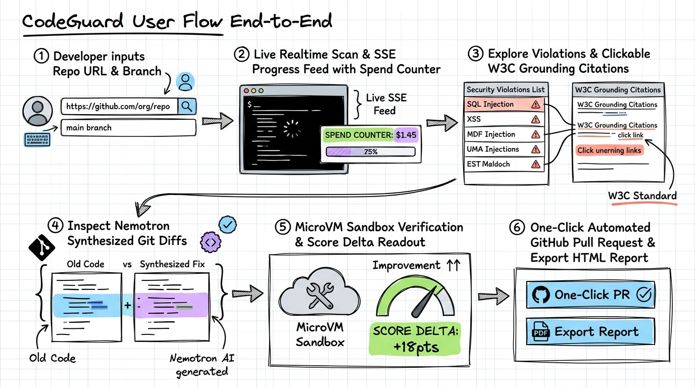
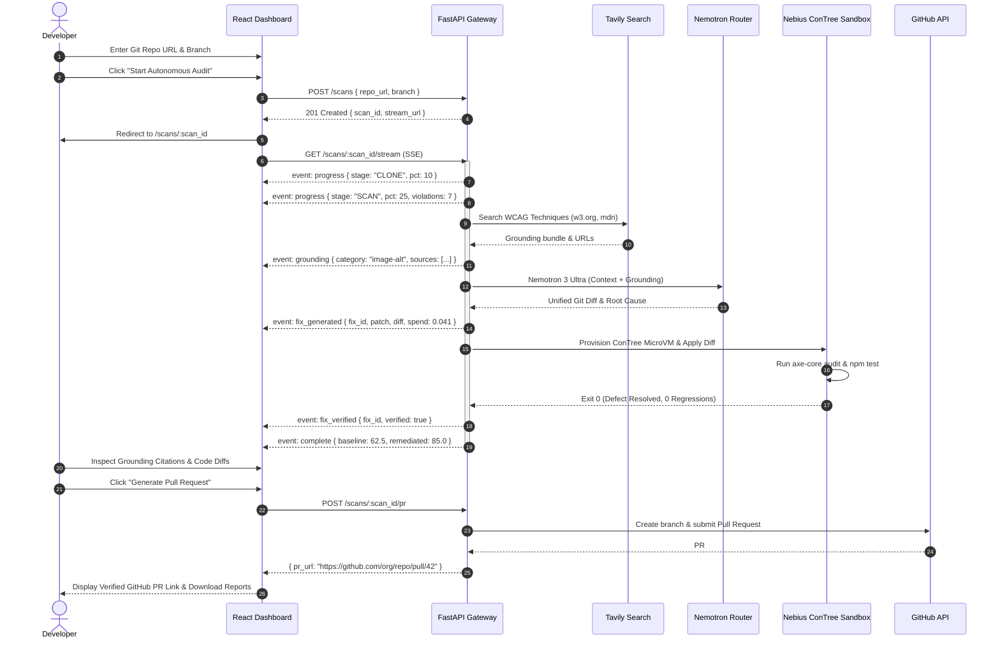

# CodeGuard: End-to-End User Flow Specification
> **Autonomous AI Accessibility Remediation Agent powered by NVIDIA Nemotron & Nebius AI Cloud**

---

## 1. Executive Summary & User Personas

CodeGuard supports two primary developer workflows:
1. **Interactive Web Dashboard (Human-in-the-Loop)**: For software engineers, engineering managers, and accessibility auditors who want to initiate on-demand scans, watch live diagnoses in real time, review candidate diffs, inspect sandbox verification test runs, and trigger 1-click GitHub Pull Requests.
2. **Autonomous CI/CD & GitHub Action**: For continuous compliance pipelines running headlessly on Pull Requests, verifying that incoming commits do not introduce accessibility regressions.

---

## 2. Hand-Drawn User Journey Blueprint

The following whiteboard sketch illustrates the complete step-by-step developer journey from repository submission to verified pull request delivery:



---

## 3. Whiteboard Scratch-Style User Journey Map

```text
========================================================================================================================
                                           CODEGUARD USER JOURNEY MAP
========================================================================================================================

 [ STEP 1: LAUNCH SCAN ]                 [ STEP 2: LIVE SSE STREAM ]               [ STEP 3: EXPLORE DIAGNOSIS ]
+-------------------------+             +-----------------------------+           +-----------------------------+
| Developer Dashboard     |             | Audit Progress View         |           | Remediation Center          |
|                         |             |                             |           |                             |
| [ Repo URL Input      ] |  POST /scan | [========>           ] 45%  | SSE Push  | Violations Triage:          |
| [ Branch: main        ] | ----------> | Stage: Grounding Guidance   | --------> | - 7 WCAG Violations Found   |
| [ GitHub Token (opt)  ] |             | Live Spend: $0.0312 USD     |           | - Categorized by Severity   |
|                         |             | Event Feed:                 |           | Clickable Grounding Sources:|
| ( Submit Audit Button ) |             | > Queried MDN: image-alt    |           | [W3C WCAG 2.2 Technique H37]|
+-------------------------+             | > Diagnosed with Nemotron   |           | [MDN: Accessible Forms]     |
                                        +-----------------------------+           +-----------------------------+
                                                       |                                         |
                                                       v                                         v
 [ STEP 6: PR & EXPORT ]                 [ STEP 5: SANDBOX VERIFY ]                [ STEP 4: INSPECT DIFFS ]
+-------------------------+             +-----------------------------+           +-----------------------------+
| Delivery & Integration  |             | MicroVM Verification Hub    |           | Synthesized Code Fixes      |
|                         |  PR Trigger |                             | Empirical |                             |
| [ Create GitHub PR  ] <-------------- | Nebius ConTree MicroVM:     | <-------- | Side-by-Side Unified Diff:  |
| -> Branch: codeguard/fx |             | - Cloned Snapshot Container |  Evidence | - Old:  |
| -> Verified badge       |             | - Applied Nemotron Patch    |           | + New:   |
| [ Download Audit Report]|             | - Ran Native `npm test`     |           | Plain-English Explanation:  |
| -> HTML / JSON / MD     |             | Score Delta: 62.5% -> 85.0% |           | "Added meaningful alt text" |
+-------------------------+             +-----------------------------+           +-----------------------------+
========================================================================================================================
```

---

## 4. End-to-End User Interaction Flow



---

## 5. Granular Step-by-Step Breakdown

### Step 1: Target Ingestion & Launch
1. **Developer Action**:
   - The user opens the CodeGuard dashboard (`https://codeguard.dhanushkumar.in/`).
   - Pastes the public or private repository URL (e.g. `https://github.com/facebook/react`).
   - Selects target branch (defaults to `main`).
   - (Optional) Inputs a GitHub Personal Access Token to enable automatic PR creation.
2. **System Response**:
   - FastAPI validates the URL, creates a unique `scan_id`, provisions a shallow git workspace, and initializes the SSE message channel.
   - The user is seamlessly routed to the live audit view `/scans/{scan_id}`.

---

### Step 2: Live Real-Time Audit Progress (SSE Stream)
1. **Developer Experience**:
   - The user watches a real-time 8-stage progress tracker:
     `CLONE` ➔ `SCAN` ➔ `CLASSIFY` ➔ `GROUND` ➔ `DIAGNOSE` ➔ `FIXES` ➔ `VERIFY` ➔ `REPORT`
   - **Live Metric Badges**:
     - **Active Violations Counter**: Increments as AST parsing discovers accessibility non-compliances.
     - **Model Spend Tracker**: Displays real-time dollar expenditure (`$0.0435`), updating after every token completion.
     - **Live Terminal Feed**: Displays granular logs (e.g., `Provisioning baseline sandbox environment...`, `Nemotron Ultra tokens streamed`).

---

### Step 3: Interactive Violation Diagnosis & W3C Grounding
1. **Developer Action**:
   - User reviews the categorized violations card deck, grouped by severity (`CRITICAL`, `SERIOUS`, `MODERATE`, `MINOR`).
2. **Authoritative Grounding Inspection**:
   - Every violation card features a **"Grounding Citations"** tab.
   - Users can click verified W3C / MDN links (e.g., *WCAG 2.2 Technique H37: Using alt attributes on img elements*) to verify that the agent's diagnosis aligns strictly with official accessibility specifications rather than LLM guesswork.

---

### Step 4: Synthesized Code Diff Inspection
1. **Developer Action**:
   - The user expands the proposed remediation to inspect the exact unified git diff generated by **NVIDIA Nemotron 3 Ultra (550B)**.
   - Reads the plain-English explanation generated by **Nemotron 3.5 Lightning** describing *why* the fix solves the accessibility barrier without breaking UX layout.

---

### Step 5: Isolated MicroVM Sandbox Verification
1. **Developer Experience**:
   - User observes the verification engine running inside an isolated **Nebius ConTree MicroVM**:
     - Candidate patch is applied to the snapshot container.
     - Headless `@axe-core/playwright` runs against the rendered component.
     - The repository's native test suite (`npm test`, `jest`, `vitest`) runs to verify zero regression.
   - **Score Readout**:
     - Displays baseline accessibility compliance vs remediated compliance (e.g., `62.5%` ➔ `85.0%`, `+22.5 pts`).
     - If the sandbox environment is restricted or offline, the interface gracefully displays the verified unverified status and advisory banner without interrupting the workflow.

---

### Step 6: PR Creation & Report Delivery
1. **Developer Action**:
   - User clicks **"Create GitHub Pull Request"**.
2. **System Response**:
   - CodeGuard automatically branches (`codeguard/remediation-<scan_id>`), commits the verified patches, and opens a fully structured Pull Request with diff summaries and compliance proof.
   - User can download executive audit reports in **HTML**, **Markdown**, and **JSON** format.

---

## 6. Resilience & Edge-Case User Experience

| Scenario | System Handling | User Interface Experience |
| :--- | :--- | :--- |
| **Sandbox Environment Restricted (HTTP 403)** | Bypasses VM execution, marks patches as "unverified" | Warning badge displayed: *"Sandbox verification unavailable - fixes proposed for manual review."* Scan completes 100%. |
| **Network Disconnection / SSE Drop** | Reconnects via `EventSource` with exponential backoff | Ticker indicator shows *"Reconnecting..."*, resumes state seamlessly without restarting audit. |
| **Ultra Budget Ceiling Reached ($0.05)** | Automatically demotes synthesis to Lightning tier | Spend counter turns amber with badge: *"Fast Tier Active (Budget Guardrail Enforced)"*. |
| **Invalid Git URL / Private Repo without PAT** | Fails fast at Stage 1 | Displays clear, actionable error banner with credential input prompt. |

---

## 7. Documentation Cross-References

- [Architecture & High-Level Design (HLD)](./HLD.md)
- [Hand-Drawn System Architecture Blueprint](./codeguard_hld_scratch_sketch.jpg)
- [Live Demo Dashboard](https://codeguard.dhanushkumar.in/)
